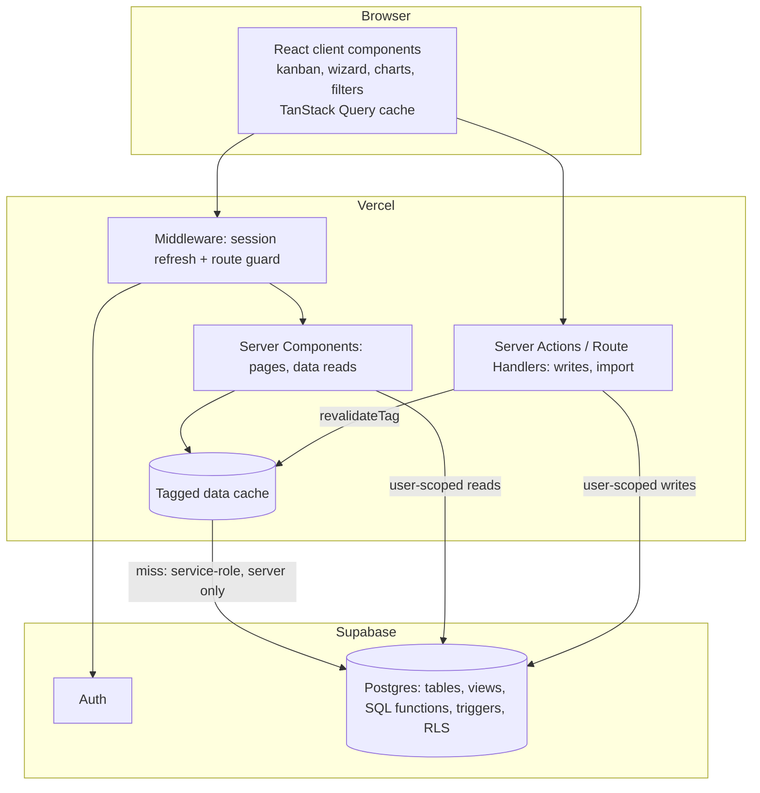
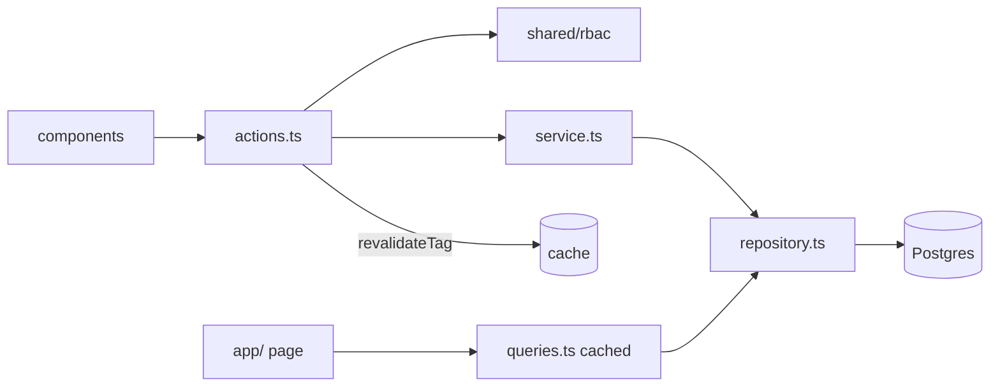
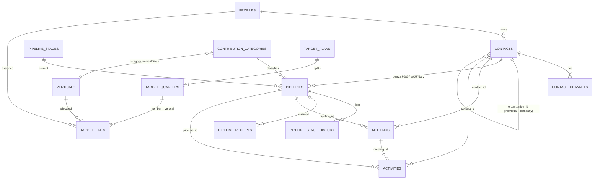
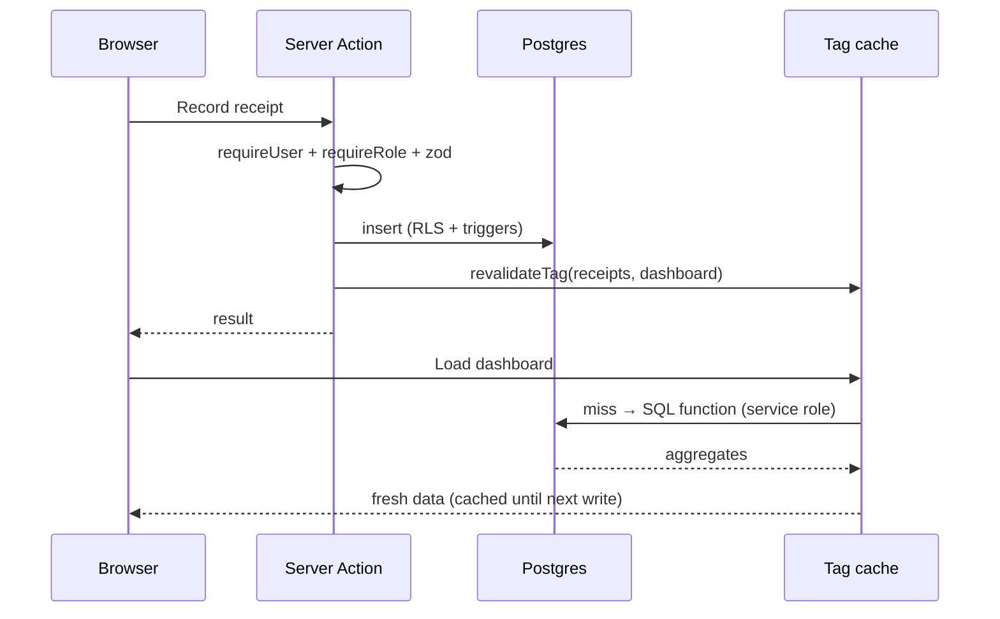
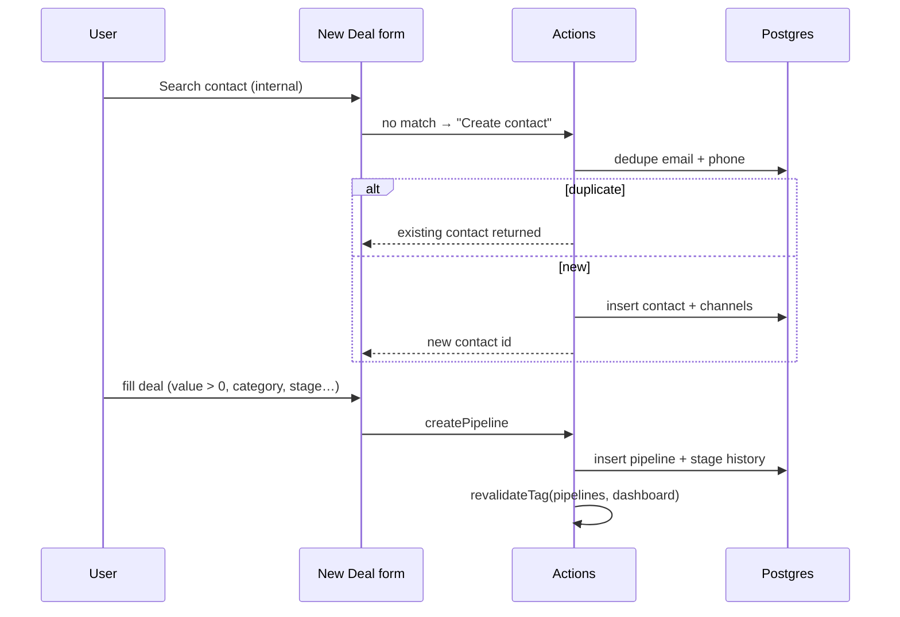
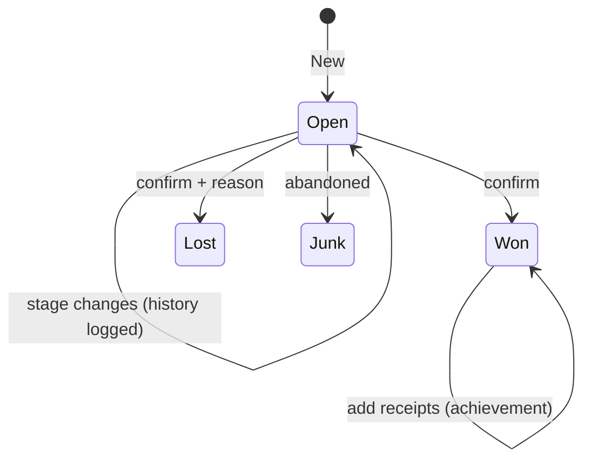
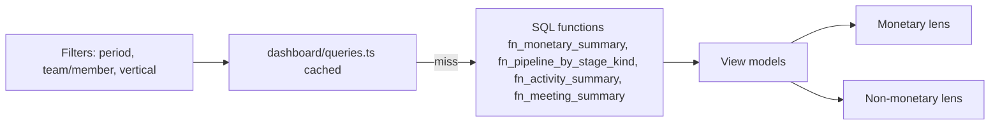
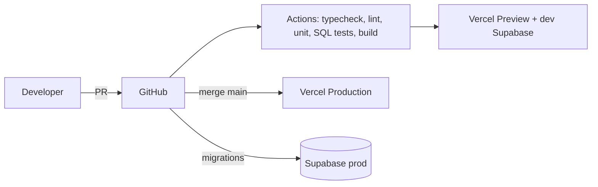

# PSE Dashboard — System Architecture

Private Sector Engagement (PSE) CRM & Performance Dashboard
Architecture style: **Modular monolith — server-rendered Next.js full-stack app on Vercel + Supabase (Postgres/Auth/RLS)**

Companion: [IMPLEMENTATION_PLAN.md](IMPLEMENTATION_PLAN.md) (requirements analysis, assumptions, phases).

---

## 1. Purpose and scope

A simplified, Odoo-like CRM for the PSE team to manage donors and sponsors, track expected and realized funds against targets, and record all non-monetary work.

**In scope:** Contacts, Pipelines (money only), Meetings, Activities (incl. events/campaigns/visits), Targets, two-lens Dashboard, Admin configuration, Odoo CSV import.

**Out of scope (explicit decisions):** Gmail/email sync, file uploads (Google Drive URLs are pasted in notes), external autofill, standalone Events module, follow-up-rate KPI, target hierarchy workflow (pending PSE).

## 2. Architectural drivers

| Driver | Consequence |
|---|---|
| Brief mandates Next.js, Supabase/MySQL, caching, Vercel, GitHub | Single Next.js deployment, Supabase Postgres, tagged server cache |
| Requirements still moving (stages, KPI definitions, verticals) | Business vocabulary lives in **config tables and SQL functions**, not hard-coded |
| Team-wide visibility, other departments blocked | Authorization enforced in the **database (RLS)** and re-checked in the server layer |
| Money correctness (targets, receipts, FX, no carry-forward) | Invariants enforced by **DB constraints and triggers**, not only UI |
| Dashboards read-heavy, writes small | Aggregation in SQL + **tag-based cache** invalidated on write |
| Small team, assessment timeline | One deployable unit; strong internal module boundaries instead of microservices |

## 3. System context

```mermaid
flowchart LR
  U[PSE team member / manager / admin] -->|HTTPS| V[Vercel: Next.js app]
  V -->|Typed SQL over Session Pooler URI (pg)| S[(Supabase Cloud: PostgreSQL + RLS)]
  V -.->|manual: Drive URLs pasted as text| G[Google Drive]
  O[Odoo export CSV] -->|upload in memory| V
  GH[GitHub] -->|push / PR| V
  GH -->|CI: test, migrate| S
```

External systems: Google Drive is **reference-only** (links in text, no API integration). Odoo is a one-time CSV source. There is no email integration.

## 4. Container / deployment view



| Unit | Runtime | Responsibility |
|---|---|---|
| Next.js app | Vercel serverless/edge (middleware at edge) | UI, orchestration, HS256 JWT auth, validation, cache |
| Supabase Postgres | Managed (Session Pooler URI `DATABASE_URL` via `pg`, no ORM) | Source of truth, constraints, RLS, aggregation functions |
| Auth & Session layer | Next.js + Postgres `profiles` (`scrypt` + HS256 JWT in HTTP-only cookies) | Identity, role verification, JWT `sub` claim passed to Postgres RLS |
| GitHub Actions | CI (`npm`) | Typecheck, lint, design check, unit tests, SQL tests, migrations |

Environments: `local` (Supabase CLI) → `preview` (per PR, dev Supabase) → `production` (main, prod Supabase). Secrets are separate per environment.

## 5. Rendering model

Hybrid: **server-rendered React (App Router) with SPA-style navigation and client-side interactive islands.**

- Server Components fetch lists, detail pages and dashboard data close to the database/cache.
- Client Components only where interactivity is needed: kanban drag-and-drop, target wizard, dashboard filters/charts, combobox/ContactPicker.
- Writes use Server Actions; no hand-written REST API except Route Handlers for CSV import and export.

## 6. Code architecture (modular monolith)

```
src/
├─ app/                       Routing only; composes modules
│  ├─ (auth)/login
│  └─ (app)/dashboard|contacts|pipelines|meetings|activities|targets|admin|import
├─ modules/<name>/
│  ├─ schema.ts               zod schemas + inferred types (single validation source)
│  ├─ repository.ts           ONLY place that talks to Supabase for this module
│  ├─ service.ts              Business rules; framework-free, unit-testable
│  ├─ actions.ts              Server Actions: authn/authz → validate → service → revalidate
│  ├─ queries.ts              Cached reads with tags
│  ├─ components/             UI for this module
│  └─ index.ts                Public API
└─ shared/ ui · lib/supabase · lib/cache · lib/rbac · lib/periods · lib/money · lib/phone
```

**Dependency rules (enforced by `eslint-plugin-boundaries`):**
`app → modules → shared`; a module imports another module **only through its `index.ts`**; only `repository.ts` imports the Supabase client; `service.ts` imports no Next/React code.



### Modules

| Module | Owns | Key rules |
|---|---|---|
| auth | login, session, `requireUser/requireRole`, profiles | PSE-only access |
| contacts | contacts, channels | ≥1 channel; dedupe on email **and** phone; inline create; structured org/designation |
| pipelines | pipelines, stage history, receipts | value > 0; in-kind needs valuation; won/lost confirm; achievement = receipts |
| meetings | meetings | linked to contact **or** pipeline; scheduled/done |
| activities | activities | 11 types; class (stewardship / prospect / independent); never affects money |
| targets | plans, quarters, lines | ΣQ = annual; Σ lines = quarter; percent verticals; locked after publish; `targets.manage` only |
| dashboard | read models | Two lenses; period/fiscal logic; cached |
| admin | stages, categories, verticals + map, currencies/FX, users, settings | Configuration over code |
| import | CSV mapper, dry-run, commit | Same dedupe rules; no file storage |

## 7. Domain model

### 7.1 Relationship model



Chain: **Contact → Pipeline → Meeting → Activity.** Meetings link to a contact or a pipeline (CHECK: at least one). Activities link to any of contact / pipeline / meeting, or none.

### 7.2 Tables

**Reference / config**
- `profiles(id, email, password_hash, full_name, role[admin|target_manager|member], team_id, is_pse, is_active)`
- `teams`, `settings(base_currency, fiscal_year_start_month, …)`
- `currencies`, `fx_rates(currency, rate_to_base, effective_from)`
- `pipeline_stages(id, name, kind[open|won|lost|junk], position)` — reports group by **kind**
- `contribution_categories` (DSP, SAC, Disaster Campaign, Project, Event & Campaign, General)
- `verticals` (DSP, VBD, Project) and `category_vertical_map`

**Core**
- `contacts(id, type[individual|company], name, organization_id, designation, website, industry, notes, status[active|inactive], owner_id, timestamps)`
- `contact_channels(id, contact_id, kind[email|phone], value, value_normalized, is_primary)` — **UNIQUE(kind, value_normalized)**; deferred constraint: ≥1 per contact
- `pipelines(id, deal_name, focal_person_id, contribution_type[cash|in_kind], category_id, party_type[individual|company], contact_id, poc_contact_id, secondary_contact_id, stage_id, expected_amount, currency, amount_base, payment_interval[one_time|monthly|quarterly|semi_annual|annual], expected_close, country, description, operational_budget, notes, in_kind_valuation_note, lost_reason, won_at, created_by, timestamps)` — CHECK `expected_amount > 0`
- `pipeline_stage_history(pipeline_id, from_stage, to_stage, changed_by, changed_at)`
- `pipeline_receipts(id, pipeline_id, amount, currency, amount_base, received_on, note)`
- `meetings(id, contact_id, pipeline_id, scheduled_at, status[scheduled|done], description, owner_id)` — organization/designation **derived by join, never stored**
- `activities(id, type, class, title, owner_id, contact_id, pipeline_id, meeting_id, related_org_name, status, remaining_work, occurred_at, due_at, notes)`
  `type ∈ {task, email, call, meeting, event, campaign, proposal, visit, servicing, prospect_engagement, general}`

**Targets**
- `target_plans(id, year, team_id, annual_amount, locked_at, locked_by)`
- `target_quarters(plan_id, quarter, amount)`
- `target_lines(quarter_id, user_id, vertical_id, percent, amount)`

**Operations**
- `audit_log(table_name, row_id, actor_id, action, diff, at)`
- `import_jobs(id, source, mapping, status, report, created_by)`

### 7.3 Invariants enforced in the database

| Invariant | Mechanism |
|---|---|
| Contact has ≥1 email/phone | Deferred constraint trigger |
| No duplicate email or phone | Unique index on normalized value |
| Pipeline value > 0 | CHECK |
| Meeting has contact or pipeline | CHECK |
| Σ quarters = annual; Σ lines = quarter | Constraint triggers |
| No target writes after lock | BEFORE trigger on all three target tables |
| Only `targets.manage` may write targets | RLS policy + trigger |
| Stage change recorded | AFTER UPDATE trigger → history |
| Every important write audited | Audit triggers |

## 8. Business logic placement

| Logic | Where | Why |
|---|---|---|
| Field validation, conditional forms | zod schema (shared by client + server) | One source of truth |
| Dedupe check UX (suggest existing contact) | service + repository | Friendly message, not just constraint error |
| FX conversion to base | service at write time; stored in `amount_base` | Historical numbers don't shift |
| Percent → money allocation | service (largest-remainder rounding) | Totals always reconcile |
| Period math (month/quarter/year, fiscal start) | `shared/lib/periods` + mirrored in SQL | Same boundaries in UI and DB |
| KPI aggregations | SQL functions | Fast, testable, swappable definitions |

### KPI definitions (current defaults, all swappable)

| KPI | Definition |
|---|---|
| **Achievement** | Σ `pipeline_receipts.amount_base` with `received_on` in period (Won-not-received shown as "won, unrealized") |
| **Pipeline value** | Σ expected `amount_base` of pipelines, grouped by stage **kind** |
| **Lead** | Pipelines created in period (formula pending PSE; isolated in `fn_lead_count`) |
| **Target (Q)** | Fixed quarterly target; no carry-forward; overachievement stays in its quarter |
| **Target (Month)** | Quarter target ÷ 3, labelled pro-rata |
| **Target (Year)** | Annual target; actual = Σ all actuals |
| **Meetings** | Count from `meetings` by status |
| **Activities** | Count from `activities` by type and class (stewardship / prospect / independent) |

Two lenses: **Monetary** (pipeline, won, receipts, attainment, vertical) and **Non-monetary** (meetings, activities, visits, events, campaigns, stewardship). They never mix.

## 9. Security architecture

### 9.1 Roles
| Role | Read | Write |
|---|---|---|
| `member` | All PSE data | Own records |
| `target_manager` | All PSE data | Own records + targets |
| `admin` | All PSE data | Everything incl. config, users |
| Non-PSE user | **Nothing** | Nothing |

### 9.2 Defence in depth
1. **Middleware** refreshes the session and redirects unauthenticated users.
2. **Server layer** `requireUser()` / `requireRole()` before any action or cached read.
3. **RLS** on every table: `SELECT` requires `is_pse_member()`; writes require owner / role.
4. **DB triggers** for lock and total invariants (cannot be bypassed by a bug in UI code).
5. **Audit log** of changes.

### 9.3 Secrets and data handling
- `DATABASE_URL` (Supabase Cloud Session Pooler URI, port `5432`) and `AUTH_SECRET` exist only in server env (never `NEXT_PUBLIC_*`); all database access runs on the server via `pg` (`node-postgres`).
- zod validation on every action; parameterised SQL queries (`$1, $2, ...`) via `pg` in `repository.ts` (no separate ORM layer).
- Drive URLs rendered as links with `rel="noopener noreferrer"`; notes are rendered as escaped text.
- Login rate limiting; no PII in logs; HTTPS only.
- Uploaded CSVs are parsed in memory and not stored.

## 10. Caching architecture

### 10.1 Layers

| # | Layer | Mechanism | Purpose |
|---|---|---|---|
| 1 | **Server data cache** | Next.js tagged cache (`use cache` + `cacheTag`, or `unstable_cache` on older versions) | Dashboard aggregates and reference data |
| 2 | **Client cache** | TanStack Query (stale-while-revalidate) | Instant filters, optimistic kanban moves |
| 3 | **Database** | Indexed SQL functions; optional materialized view | Cheap cache misses |
| 4 | *(optional)* Redis | Upstash via Vercel Marketplace | Shared cache if scaled out |

### 10.2 Why sharing the cache is safe
All PSE members may see all PSE data, so cached results are identical for every authorized user. Cached functions cannot read request cookies, so they use the server-only service-role client; therefore **authorization is performed by the caller before the cache is hit**. Cache keys contain only filter parameters (period, team/member, vertical), never user identity.

### 10.3 Write → invalidation map

| Write | Tags revalidated |
|---|---|
| Pipeline create/update/stage change | `pipelines`, `dashboard` |
| Receipt add/edit | `receipts`, `dashboard` |
| Meeting change | `meetings`, `dashboard` |
| Activity change | `activities`, `dashboard` |
| Target publish | `targets`, `dashboard` |
| Admin config change | `config`, `dashboard` |

Fallback TTL: 5 minutes. Acceptance test: write → dashboard reflects change on next request, with no stale value.



## 11. Key flows

### 11.1 New Deal with inline contact creation


### 11.2 Pipeline lifecycle and achievement

Won creates no achievement by itself; **achievement accrues as receipts are recorded.**

### 11.3 Target setup (state machine)

```mermaid
stateDiagram-v2
  [*] --> Draft
  Draft --> Draft: annual → Q1–Q4 → members → verticals (%)
  Draft --> Locked: Publish (ΣQ = annual, 100% per split)
  Locked --> [*]: read-only; DB trigger blocks edits
```


### 11.4 Odoo import
Upload CSV → map columns → **dry-run** (valid / duplicate / error report) → commit in transaction → `import_jobs` record. Same dedupe and validation rules as manual entry.

## 12. Dashboard data flow



Tabs: Monthly / Quarterly / Annual. Drill-down from any tile to a pre-filtered list.

## 13. Non-functional requirements

| Area | Target |
|---|---|
| Performance | Warm dashboard server time ≲ 300 ms on 10k contacts / 5k pipelines / 20k activities; measured and recorded |
| Consistency | Dashboard never stale after a write (tag invalidation test) |
| Availability | Vercel + Supabase managed SLAs; Supabase daily backups |
| Scalability | Stateless app; aggregation in SQL; Redis and matview as upgrade path |
| Maintainability | Module boundaries by lint; ADRs; generated DB types |
| Accessibility / UX | Responsive; keyboard-usable forms; accessible chart palette |
| Observability | Vercel logs + runtime errors; structured server logs |

## 14. Testing strategy

| Level | Tooling | Covers |
|---|---|---|
| Unit | Vitest | services, period math, money/rounding, phone normalization |
| Database | SQL tests | unique/dedupe, CHECKs, lock trigger, totals, RLS (PSE vs non-PSE) |
| E2E | Playwright | login → contact (dup blocked) → deal with inline contact → won → receipt → dashboard → targets lock |
| Non-functional | Lighthouse, axe, load seed | performance and accessibility |

## 15. CI/CD and environments



Branching: `main` (prod) ← `develop` ← feature branches; Conventional Commits; protected `main`. Schema changes only via versioned migrations in `supabase/migrations`.

## 16. Architecture decisions (ADR index)

| ADR | Decision | Rationale |
|---|---|---|
| 001 | Supabase Postgres, not MySQL | Auth + RLS + SQL functions, one vendor |
| 002 | Modular monolith, no separate backend | Vercel is serverless; no need for a second service |
| 003 | Server Actions for writes | Co-located validation/authz, fewer moving parts |
| 004 | Tagged server cache + client cache | Fast dashboards, correct invalidation |
| 005 | Achievement = receipts | Forecast ≠ realized |
| 006 | Category and vertical are separate dimensions with mapping | Terminology unresolved with PSE |
| 007 | Stages, categories, verticals are config | Stages not finalized |
| 008 | Invariants in DB triggers/constraints | Money rules must not depend on UI |
| 009 | Drive URLs in notes, no storage | Storage concerns raised in meeting |
| 010 | Direct PostgreSQL Session Pooler URI (`DATABASE_URL` + `pg`) & Typed SQL (no ORM) | Works across IPv4/Vercel without extra Supabase API keys; directly supports deferred constraints, custom triggers, RLS, and SQL functions |
| 011 | Self-contained HS256 JWT Cookie + Postgres `scrypt` Auth | Zero external auth service dependency; passes `sub` claim into Postgres transactions for RLS |
| 012 | `npm` as package manager | Standardized on `npm` (`package-lock.json`, `npm ci`) for local dev and GitHub Actions |

## 17. Extension points

- **Event-specific module** (budgets, participants, ROI): add `modules/events` linked to activities.
- **Count targets** (meetings/events): add `kpi_targets` and extend `fn_*` summaries.
- **Follow-up rate KPI**: add a SQL function once PSE defines formula, trigger and window.
- **Target hierarchy**: extend `target_lines` ownership and `targets.manage` once PSE decides.
- **Background jobs / external API**: add Route Handlers or a worker service without touching modules.

## 18. Risks and open items

| Risk | Mitigation |
|---|---|
| Moving requirements | Config tables, swappable SQL KPIs, ADRs |
| Cache stale / leaking data | Auth before cache; PSE-only data; invalidation tests |
| Achievement misread | Labels: Forecast / Won / Realized on every tile |
| Rounding drift in allocations | Largest-remainder + DB total constraints |
| Scope creep | Written out-of-scope list (§1) |

Open items for PSE (stages, Lead formula, VBD vs SAC, achievement basis, monthly target, fiscal year/currency, Odoo mapping, tracker columns) are listed in Part E of [IMPLEMENTATION_PLAN.md](IMPLEMENTATION_PLAN.md).
