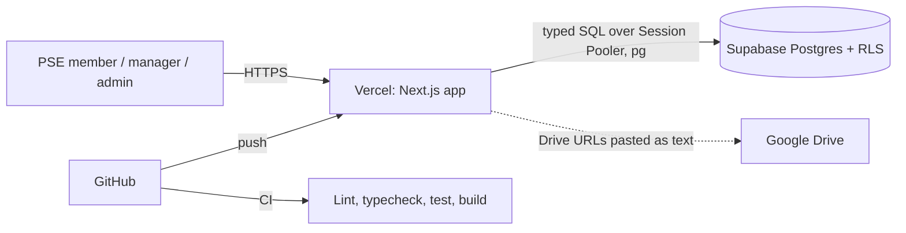
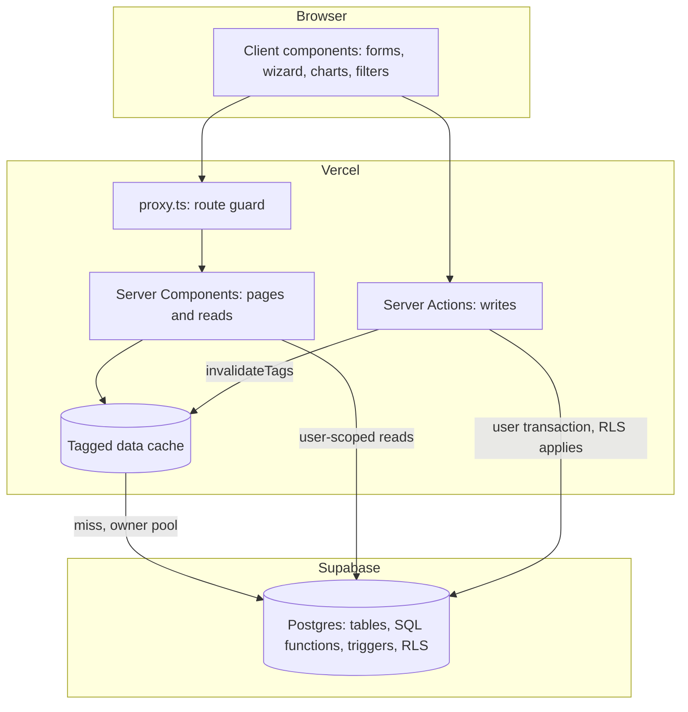
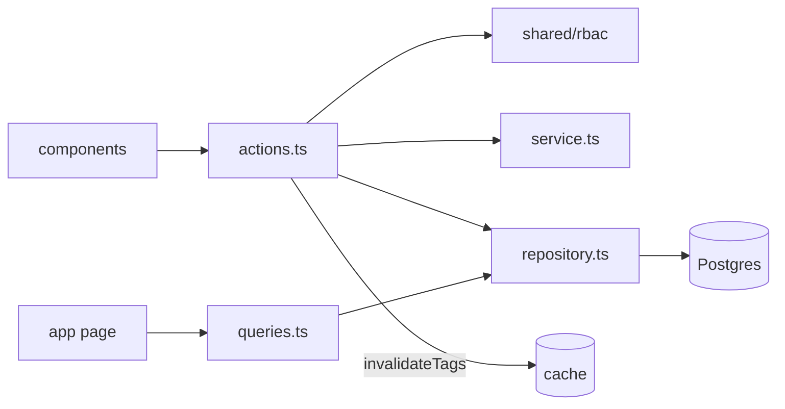
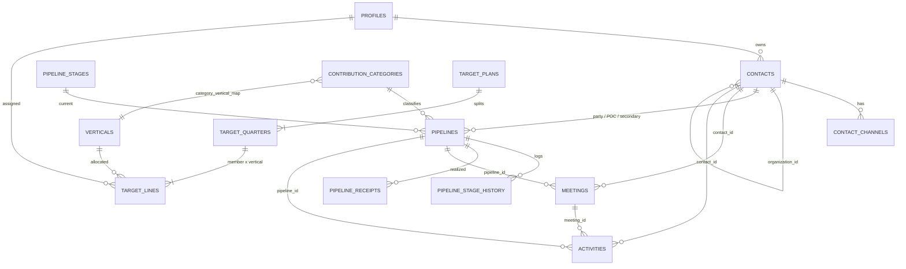
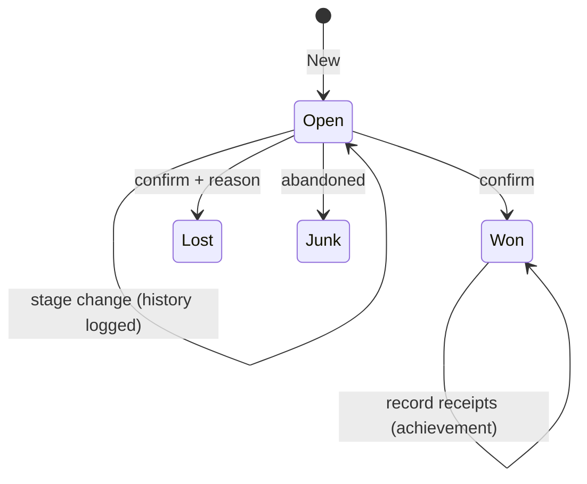
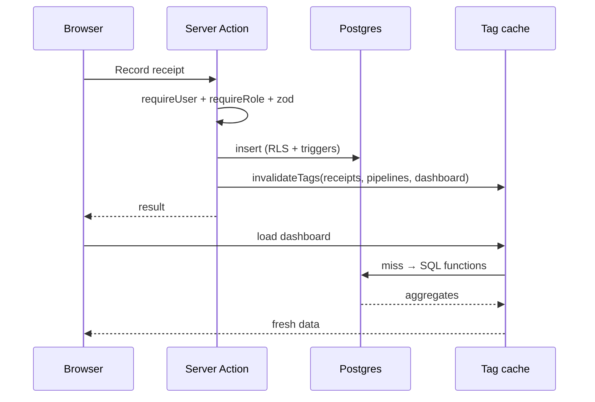

# 02 · Architecture and Database

Style: **modular monolith.** One server-rendered Next.js app on Vercel, with Supabase Cloud Postgres as the source of truth. There is no separate backend.

## 1. Architectural drivers

| Driver | Consequence |
|---|---|
| Brief mandates Next.js, Postgres, caching, Vercel, GitHub | One Next.js deployment, Supabase Postgres, tagged server cache |
| Requirements still moving | Business vocabulary lives in config tables and SQL functions, not code |
| Team-wide visibility, other departments blocked | Authorisation enforced in the database (RLS) and re-checked in the server layer |
| Money correctness | Invariants enforced by DB constraints and triggers, not only the UI |
| Read-heavy dashboards, small writes | Aggregation in SQL plus tag-based cache invalidated on write |
| Small team, fixed deadline | One deployable unit with strong internal module boundaries |

## 2. System context



Google Drive is reference-only (links in text, no API). There is no email integration.

## 3. Runtime view



| Unit | Responsibility |
|---|---|
| Next.js app (Vercel) | UI, orchestration, HS256 JWT sessions, validation, cache |
| Supabase Postgres | Source of truth, constraints, RLS, aggregation functions |
| `src/proxy.ts` | Redirects unauthenticated visitors to `/login` for all app routes |
| GitHub Actions | `npm ci` → lint → lint:design → typecheck → test → build (Node 22) |

Rendering is hybrid: Server Components fetch data. Client Components are used only where interaction is needed (target wizard, dashboard filters and charts, combobox, `ContactPicker`). Writes use Server Actions. There is no hand-written REST API.

## 4. Code architecture

```
src/
├─ app/        routing only; thin pages compose modules
│  ├─ (auth)/login   no-access
│  └─ (app)/dashboard | contacts[/id] | pipelines[/id] | meetings | activities | targets | admin
├─ modules/<name>/   schema.ts · service.ts · repository.ts · actions.ts · queries.ts · components/ · index.ts
├─ shared/     ui/ · lib/{supabase, cache, rbac, money, periods, phone}
└─ types/      database.ts (hand-maintained to match migrations)
```

Dependency direction is `app → modules → shared → types`, enforced by `eslint-plugin-boundaries`. A module imports another only through `@/modules/<name>` (its `index.ts`).

| File | Role |
|---|---|
| `schema.ts` | zod. Single validation source for client and server |
| `service.ts` | Pure business rules. No framework or DB imports. Unit-tested |
| `repository.ts` | Only place that talks to the database. Parameterised SQL via `pg`, no ORM |
| `actions.ts` | `'use server'`. Authorise → zod parse → service → repository → `invalidateTags` + `revalidatePath`. Returns `{ status: 'success' | 'error' }` |
| `queries.ts` | Page reads. Calls `requireUser()` before any cached read |



### Modules

| Module | Owns | Key rules |
|---|---|---|
| `auth` | Login, session, `requireUser`/`requireRole`, profiles, admin users | PSE-only access; lockout after 5 failures |
| `contacts` | Contacts, channels, `ContactPicker` | ≥1 channel; dedupe on email and phone |
| `pipelines` | Pipelines, stage history, receipts | amount > 0; in-kind needs valuation; achievement = receipts |
| `meetings` | Meetings | contact or pipeline required |
| `activities` | Activities | 11 types, 3 classes, never affects money |
| `targets` | Plans, quarters, lines, wizard | ΣQ = annual; locked after publish |
| `dashboard` | Read models | Two lenses; period and fiscal logic; cached |
| `admin` | Users and reference tables screen | Admin only |

## 5. Authentication and authorisation

- **Auth:** `profiles` (scrypt hashes) plus an HS256 JWT in the HTTP-only cookie `pse_session`, signed with `AUTH_SECRET` (32+ chars in production; no default).
- **Database access:** `DATABASE_URL` (Session Pooler, port 5432) through `pg`. No Supabase client SDK or API keys.
- **User-scoped work:** `withUserTransaction(userId, fn)` runs `SET LOCAL ROLE authenticated` and sets `request.jwt.claim.sub` / `app.current_user_id`, so RLS applies.
- **Owner pool (`queryDb`):** used only for login, session checks, and reads that run after `requireUser()`.

| Role | Read | Write |
|---|---|---|
| `member` | All PSE data | Own records |
| `target_manager` | All PSE data | Own records and targets |
| `admin` | All PSE data | Everything, including users and config |
| Non-PSE user | Nothing | Nothing |

Defence in depth, in order: (1) `proxy.ts` route guard, (2) `requireUser()` / `requireRole()` in the server layer, (3) RLS on every table (`is_pse_member()` for select, owner or role for writes), (4) triggers for lock and total invariants, (5) `audit_log`.

Hardening: login timing equalised with a dummy hash, `login_attempts` lockout (5 failures per email in 15 minutes), `password_hash` column privilege revoked from `authenticated`, secrets never `NEXT_PUBLIC_*`, Drive links rendered with `rel="noopener noreferrer"`.

## 6. Domain model



## 7. Database

Source of truth is `supabase/migrations/*.sql`. Migrations are forward-only; never edit an applied file. Next number is **011**.

### 7.1 Migrations

| File | Content |
|---|---|
| `001_enums_and_config` | 11 enums; `teams`, `profiles`, `settings`, `currencies`, `fx_rates`, `pipeline_stages`, `contribution_categories`, `verticals`, `category_vertical_map` |
| `002_contacts` | `contacts`, `contact_channels`, deferred "≥1 channel" constraint triggers |
| `003_pipelines` | `pipelines`, `pipeline_stage_history`, `pipeline_receipts`, stage-history and `won_at` / `lost_reason` triggers |
| `004_meetings_activities` | `meetings`, `activities` |
| `005_targets` | `target_plans`, `target_quarters`, `target_lines`, lock-guard triggers, `publish_target_plan(uuid)` |
| `006_audit_rls` | `audit_log`, `current_app_user_id()`, `is_pse_member()`, `has_role()`, audit triggers, RLS on all business tables |
| `007_security_hardening` | `login_attempts`, column-level revoke of `profiles.password_hash` |
| `008_targets_publish_guard` | Role check inside `publish_target_plan` |
| `009_dashboard_functions` | Dashboard SQL read functions |
| `010_dashboard_perf_indexes` | Covering indexes, sargable date predicates, single-pass CTE rewrites |

`supabase/seed.sql` holds idempotent reference data. `schema_migrations` (the ledger) is created by `scripts/db-push.mjs`, not by a migration.

### 7.2 Tables

**Reference and config**

| Table | Notes |
|---|---|
| `profiles` | `id, email, password_hash, full_name, role[admin\|target_manager\|member], team_id, is_pse, is_active` |
| `teams`, `settings`, `currencies` | `settings` holds `base_currency` and `fiscal_year_start_month` |
| `fx_rates` | `currency, rate_to_base, effective_from`; latest row on or before the date is used |
| `pipeline_stages` | `id, name, kind[open\|won\|lost\|junk], position` |
| `contribution_categories` | DSP, SAC, Disaster Campaign, Project, Event & Campaign, General |
| `verticals`, `category_vertical_map` | DSP, VBD, Project; map is editable |

**Core**

| Table | Notes |
|---|---|
| `contacts` | `type[individual\|company], name, organization_id, designation, website, industry, notes, status, owner_id` |
| `contact_channels` | `kind[email\|phone], value, value_normalized, is_primary`; **UNIQUE(kind, value_normalized)** |
| `pipelines` | Deal, focal person, `contribution_type[cash\|in_kind]`, category, `party_type`, contact / POC / secondary, stage, `expected_amount`, `currency`, `amount_base`, `payment_interval`, `expected_close`, `in_kind_valuation_note`, `lost_reason`, `won_at` |
| `pipeline_stage_history` | `pipeline_id, from_stage, to_stage, changed_by, changed_at` |
| `pipeline_receipts` | `pipeline_id, amount, currency, amount_base, received_on, note` |
| `meetings` | `contact_id, pipeline_id, scheduled_at, status[scheduled\|done], description, owner_id`. Organisation and designation are derived by join, never stored |
| `activities` | `type` (11), `class` (3), title, owner, optional contact / pipeline / meeting, `related_org_name`, `status[planned\|in_progress\|done\|cancelled]`, `remaining_work`, `occurred_at`, `due_at`, notes |

Activity types: `task, email, call, meeting, event, campaign, proposal, visit, servicing, prospect_engagement, general`. Default class: `servicing → stewardship`, `prospect_engagement → prospect_engagement`, others `→ independent`.

**Targets and operations**

| Table | Notes |
|---|---|
| `target_plans` | `year, team_id, annual_amount, locked_at, locked_by`; UNIQUE(year, team_id) |
| `target_quarters` | `plan_id, quarter 1–4, amount`; UNIQUE(plan_id, quarter) |
| `target_lines` | `quarter_id, user_id, vertical_id, percent, amount`; UNIQUE(quarter_id, user_id, vertical_id) |
| `audit_log` | Table, row id, actor, action, diff, time |
| `login_attempts` | Failed sign-in tracking per email |

`import_jobs` is **not** created yet. It is part of the importer design (`07_Migration.md`).

### 7.3 Invariants enforced in the database

| Invariant | Mechanism |
|---|---|
| Contact has ≥1 email or phone | Deferred constraint triggers on `contacts` and `contact_channels` |
| No duplicate email or phone | Unique index on normalised value |
| Pipeline `expected_amount` > 0 | CHECK |
| In-kind needs a valuation note | CHECK |
| Company pipeline needs a POC | CHECK `pipelines_company_poc_check` |
| Meeting has contact or pipeline | CHECK |
| Receipt amount > 0 | CHECK |
| Stage change recorded; `won_at` set on won | Triggers |
| Σ quarters = annual; Σ lines = quarter | Checked in `publish_target_plan` |
| No target writes after lock | BEFORE triggers on all three target tables |
| Only admin / target_manager write targets | RLS policy and publish function role check |
| Members cannot edit others' records | RLS owner check (`owner_id = current_app_user_id() OR has_role(admin)`) |
| Important writes audited | `fn_audit_trigger` |

`SECURITY DEFINER` functions bypass RLS, so each one checks the caller's role itself.

### 7.4 Dashboard SQL functions (`009`, rewritten in `010`)

| Function | Returns |
|---|---|
| `fn_achievement` | Receipts by member and vertical |
| `fn_target` | Quarter exact, month = quarter ÷ 3 (rounded per line), year = sum. Published plans only |
| `fn_pipeline_by_kind` | Count and value by stage kind, cash vs in-kind. Pipelines **created** in the period |
| `fn_won_unrealized` | Won amount minus receipts, floored at zero per deal. Deals **won** in the period |
| `fn_lead_count` | Pipelines created in the period (swappable Lead definition) |
| `fn_meeting_summary` | Meetings by status |
| `fn_activity_summary` | By type and class. Dated by `occurred_at`, else `due_at`, else `created_at`. Cancelled excluded |
| `fn_contacts_engaged` | Distinct contacts across meetings and activities |
| `fn_member_workload` | Meetings and activities per active PSE member |
| `fn_trend` | 12 fiscal months of achievement |
| `fn_fiscal_start_month` | Reads the setting |

### 7.5 Business logic placement

| Logic | Where |
|---|---|
| Field validation, conditional forms | zod schema (client and server) |
| Duplicate-contact message | service and repository (friendly error before the constraint) |
| FX conversion | service at write time, stored in `amount_base` so history does not shift |
| Percent → money | service, largest-remainder rounding (totals reconcile to the cent) |
| Period math | `shared/lib/periods`, mirrored in SQL |
| KPI aggregation | SQL functions |

## 8. Caching architecture

| Layer | Mechanism | Purpose |
|---|---|---|
| 1. Server tagged cache | `cached()` / `invalidateTags()` in `@/shared/lib/cache` (wraps Next `unstable_cache` and `revalidateTag`), 300 s fallback TTL | Dashboard aggregates and reference reads |
| 2. Client | `useTransition` and local lens state | Switching lenses costs no network round trip |
| 3. Database | Indexed SQL functions, covering indexes, one SQL round trip per lens | Cheap cache misses |

**Why sharing the cache is safe.** All PSE members may see all PSE data, so cached results are identical for every authorised user. Cached functions cannot read cookies, so they use the owner pool. Therefore **authorisation happens before the cached call**, and cache keys contain filters only, never user identity.

Write → tag table: see `05_Technical_Docs.md` §6. Measured results: see §7 there.

## 9. Key flows

**Pipeline lifecycle**



Won creates no achievement by itself. Achievement accrues as receipts are recorded.

**Target plan**

```mermaid
stateDiagram-v2
  [*] --> Draft
  Draft --> Draft: annual → Q1–Q4 → members → verticals (%)
  Draft --> Locked: Publish (ΣQ = annual, 100% per split)
  Locked --> [*]: read-only; DB trigger blocks edits
```



**Write and invalidate**



## 10. Architecture decisions

| ADR | Decision | Rationale |
|---|---|---|
| 001 | Supabase Postgres, not MySQL | RLS, SQL functions, deferred constraints, one vendor |
| 002 | Modular monolith, no separate backend | Vercel is serverless; no second service needed |
| 003 | Server Actions for writes | Co-located validation and authorisation |
| 004 | Tagged server cache plus lens state on the client | Fast dashboards, correct invalidation |
| 005 | Achievement = receipts | Forecast is not realised money |
| 006 | Category and vertical are separate, with a map | Terminology unresolved with PSE |
| 007 | Stages, categories, verticals are config | Stages not finalised |
| 008 | Invariants in DB triggers and constraints | Money rules must not depend on the UI |
| 009 | Drive URLs in notes, no storage | Storage concerns raised in the meeting |
| 010 | Session Pooler URI with `pg` and typed SQL, no ORM | Works over IPv4 and Vercel; supports triggers, RLS, SQL functions |
| 011 | Self-contained HS256 cookie plus scrypt auth | No external auth service; passes `sub` into Postgres for RLS |
| 012 | `npm` only | One lockfile for local and CI |

## 11. Extension points

- Events module (budgets, participants): add `modules/events` linked to activities.
- Count targets: add `kpi_targets` and extend the `fn_*` summaries.
- Follow-up rate KPI: add a SQL function once PSE defines formula, trigger and window.
- Target hierarchy: extend `target_lines` ownership once PSE decides.
- Odoo importer: see `07_Migration.md`.
- Shared cache for scale-out: replace the body of `cached()` (for example with Redis). Callers do not change.
